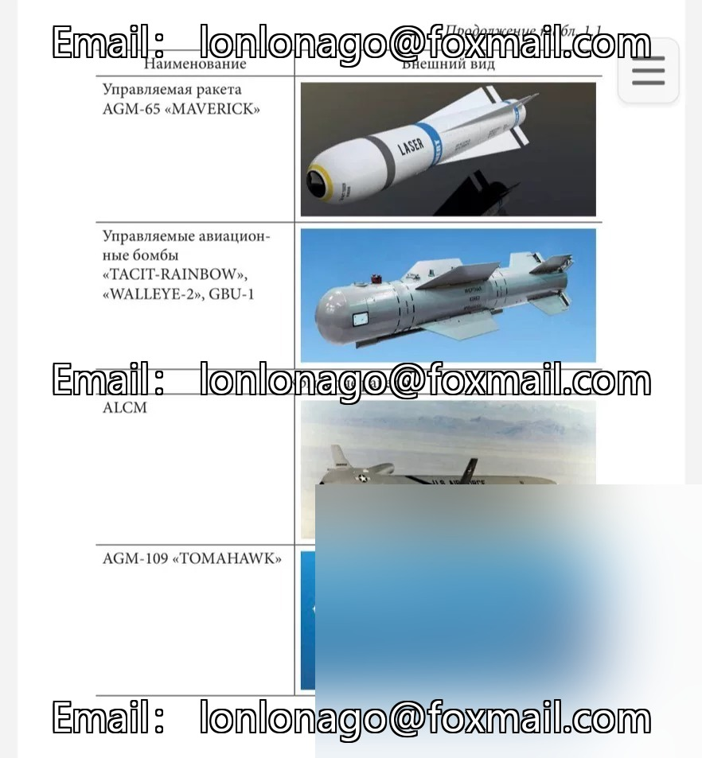
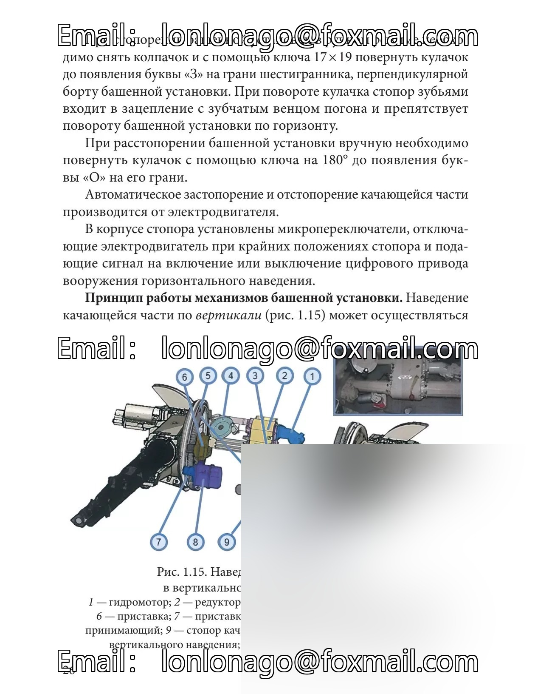
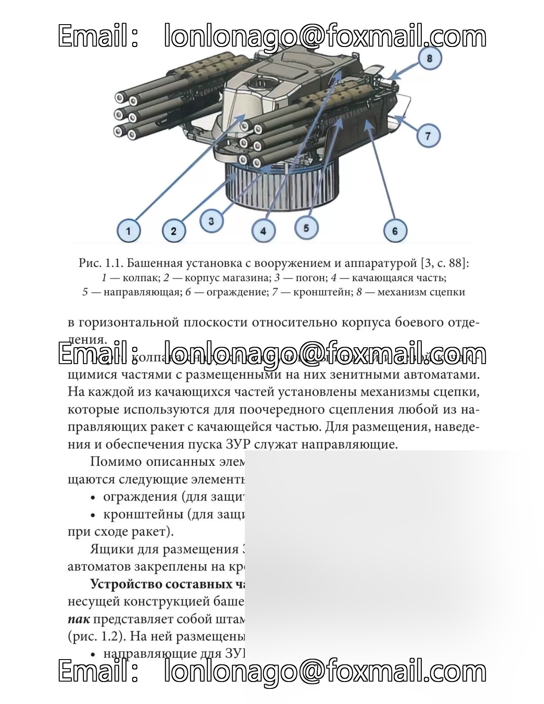
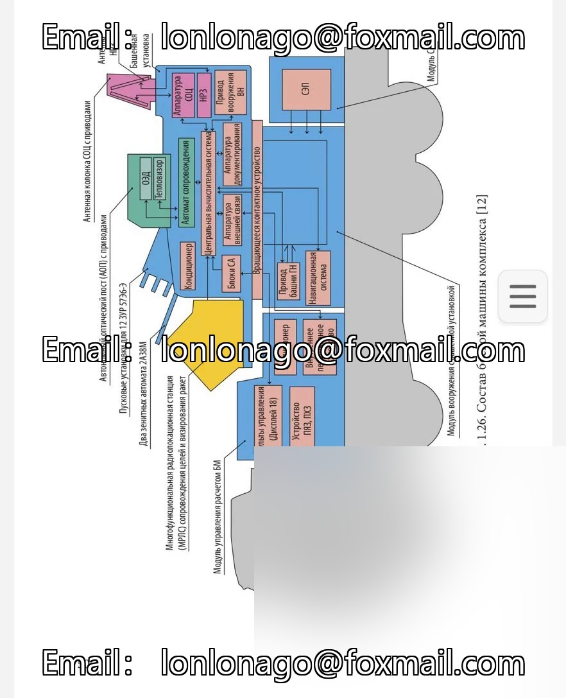

# The 'Armor-S' air defense missile cannon system, its main and auxiliary systems" PDF

## Body

"The PDF of the 'Kchema-S' air defense missile gun system's main and auxiliary systems", 230 pages, 2022 Urals Federal University textbook, reviewed by Russian experts, covering system tactical performance, composition, operational purposes, and the working principles of each unit, suitable for study in air defense specialized fields.
"The 180-page structure and operating basics of the 'Kchema-S' combined gun-air defense system (ZRPK) (general information)"
Kchema-S materials, high reference value, , not returned upon sale.

The PDF is the textbook on the main and auxiliary systems of the “Kiron-S” air defense missile and cannon system, covering tactical performance, composition, combat uses and the principles of each unit, along with related missile models and operational content.

<!-- AI_ENRICHED -->

## Images

## Payment

Here is a pay link on Stripe ( https://buy.stripe.com/3cs8yP7sY87d0vu9AB ). Please contact me lonlonago@foxmail.com after funding $89, and I will send you a complete data files , thank you!

